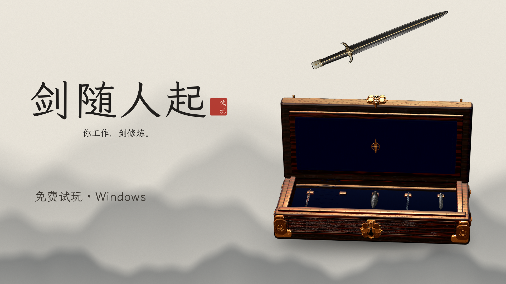

# 剑随人起 · 试玩版 / Sword Chest – Test Build

国风修仙桌宠：一只剑匣待在桌面右下角，剑随你的电脑使用慢慢修炼。陪伴、成长、收藏、轻自律——74 把剑分属十条剑道。

A xianxia desktop pet for Windows: a sword chest sits in the corner of your desktop and its swords cultivate while you work.

## 下载 / Download

到 [Releases](../../releases/latest) 下载 `SwordChest-demo-v2.01-win64.zip`（约 230 MB）。

Get `SwordChest-demo-v2.01-win64.zip` (~230 MB) from [Releases](../../releases/latest).

## 开始

1. 把整个压缩包解压到任意文件夹（不要在压缩包里直接运行）。
2. 双击「剑匣.exe」。
3. 如果出现「Windows 已保护你的电脑」：点「更多信息」→「仍要运行」。程序暂时没有做代码签名。
4. 剑匣出现在屏幕右下角，待在所有窗口下面。

- 左键点剑匣里的剑：选中，剑会升起。剑匣下方的按钮：放飞 / 召回 / 开合剑匣 / 主动修炼 / 更多。
- Ctrl+Alt+F9 放飞或召回当前飞剑，Ctrl+Alt+Q 退出。托盘图标右键菜单也能操作。
- 进度保存在「剑匣.exe」旁边的 userdata 文件夹。游戏不联网，不上传任何数据。

## Getting started

1. Extract the whole zip to any folder (don't run it from inside the zip).
2. Run "剑匣.exe" (the Chinese file name is expected).
3. If Windows says "Windows protected your PC": click More info → Run anyway. The build isn't code-signed yet.
4. Switch to English with the 中 / EN toggle at the top right of the More window.

- Left-click a sword to select it. The bar under the chest: release / recall / open-close / focus session / more.
- Ctrl+Alt+F9 releases or recalls the current sword. Ctrl+Alt+Q quits.
- Progress is saved in the "userdata" folder next to the exe. Works offline; nothing is sent anywhere.

## 反馈 / Feedback

- 中文问卷（2 分钟）：https://wj.qq.com/s2/28440862/nbrx/
- English survey (2 min): https://tally.so/r/laBBoo
- 游戏内：「更多」窗口右上角「反馈」。In game: Feedback at the top right of the More window.

系统要求 / Requirements: Windows 10/11, 64-bit.
